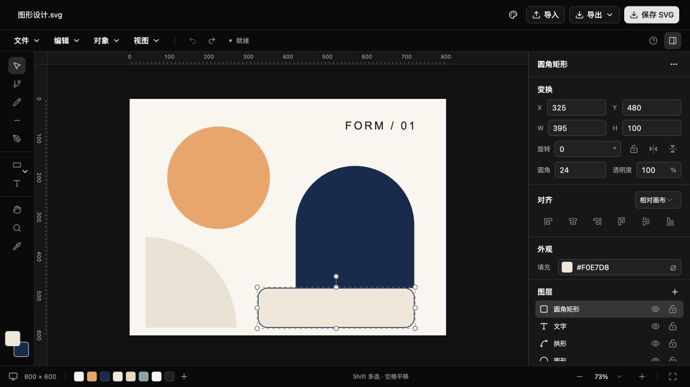

# SVG Studio

[简体中文](README.md) · [Known issues](docs/known-issues.md) · [Engine integration](docs/engine.md) · [Contributing](CONTRIBUTING.md)

[](https://github.com/Hello-job/svg-studio/actions/workflows/ci.yml)
[](LICENSE)

A self-hostable SVG editor built with **React, TypeScript, and SVG-Edit**, using **shadcn/ui's default monochrome dark theme**. A compact toolbar, contextual inspector, and object list keep the canvas in focus.

Open an SVG, edit shapes and paths, then download SVG or PNG. Files are processed in the browser. No account, API key, database, or backend is required. The latest draft and theme preferences are stored in the current browser.



> **Experimental v0.1.0.** Some attribute edits do not trigger draft saving, and arrow-key movement of a multi-selection can overwrite individual object transforms. Keep original files and download SVG regularly. See [known issues](docs/known-issues.md) before relying on the editor for important work.

## Features

- Shapes: rectangle, ellipse, line, pencil, pen, text, fixed-parameter stars and hexagons.
- Paths: select and drag nodes, add/delete nodes, line/curve conversion, open/close paths.
- Inspector: position, dimensions, aspect ratio, rotation, flips, corner radius, opacity, fill, stroke, dashes, caps, joins, and blur.
- Text: basic font selection, size, bold, italic, and content editing.
- Objects: cut/copy/paste, duplicate, group/ungroup, stacking order, alignment, and distribution.
- Object list: visibility, locking, Shift selection, and double-click renaming.
- View: zoom, fit, pan, rulers, transparency checkerboard, and a collapsible inspector.
- Files: new canvas, SVG import/drop, source editing, SVG download, and PNG export at document size.
- Appearance: neutral by default; optional presets, custom HEX colors, reset, and persisted preferences.

Undo/redo, keyboard shortcuts, draft restoration, and replacement prompts are connected, with known edge cases. This is an early editor implementation, not full professional vector-editing coverage. The interface currently uses Simplified Chinese.

## Quick start

Use **Node.js 22.12+** (24 recommended) and **pnpm 11**. The exact pnpm version is pinned in `package.json`.

```sh
git clone https://github.com/Hello-job/svg-studio.git
cd svg-studio
corepack enable
pnpm install --frozen-lockfile
pnpm dev
```

Open [http://127.0.0.1:4317/](http://127.0.0.1:4317/). The server fails if port 4317 is already occupied.

No environment variables are required. `localhost` and `127.0.0.1` have separate browser storage; use one origin consistently.

## Basic workflow

1. Draw with the left toolbar or open an SVG from the File menu.
2. Select an object to edit its properties in the right inspector.
3. Shift-click to select multiple objects. Hold Space or use H to pan.
4. Select a path and switch to the node tool. Use the inspector button to delete nodes; the Delete/Backspace shortcut is incomplete.
5. Download SVG with the top-right save button. The export menu also provides PNG and SVG source editing.

Common shortcuts: V selection, A nodes, R rectangle, O ellipse, P pen, T text, Ctrl/Cmd + S save, Ctrl/Cmd + Z undo. The help button lists the supported shortcuts.

## Themes and customization

The default is **shadcn/ui New York / Neutral in dark mode**. There is no default colored primary button and no light mode.

The palette button opens appearance settings: Neutral, Blue, Violet, Green, Orange, Rose, or a custom HEX color. Reset restores monochrome. Theme changes affect editor controls and selection indicators, not artwork colors or exports.

- `src/styles.css`: shadcn semantic tokens and compact editor layout.
- `src/lib/theme.ts`: presets, defaults, validation, and preference loading.
- `src/components/theme-settings.tsx`: appearance panel.
- `src/components/ui/`: editable shadcn/ui component source.
- `components.json`: component paths and style configuration.

## Build and self-host

```sh
pnpm build
pnpm preview
```

Serve the generated `dist/` directory with a static server. No Node.js backend is needed. `pnpm preview` is for local build inspection, not production hosting.

For a subdirectory such as `/svg-studio/`, build with the matching asset prefix:

```sh
pnpm build --base=/svg-studio/
```

The SVG-Edit engine is loaded separately. Its approximately 1.1 MB chunk produces a known build warning. The threshold has not been raised to hide it.

There is no hosted public demo bundled with this repository.

## Embedding in another project

This release contains the **standalone application source**. It is not an npm-installable React component library and does not expose a stable host messaging API. `private: true` prevents accidental npm publication; it does not restrict the MIT source license.

After building and hosting the editor at `/svg-studio/`, it can be embedded in an iframe:

```html
<iframe
  src="/svg-studio/"
  title="SVG Studio editor"
  style="width: 100%; height: 720px; border: 0"
></iframe>
```

Import/export still happens through the editor UI. This example does not provide a host-to-editor SVG input API.

Before copying components directly into a React app, read the [engine notes](docs/engine.md). SVG-Edit 7.4.2 shares module state and lacks complete public teardown support. Only one engine instance is initialized per page; adding StrictMode, repeated mounting, or multiple side-by-side instances is not currently supported.

## Files and import boundaries

- The application has no upload, account, or cloud-save workflow.
- Browser storage holds only the latest document, without undo history. Clearing site data removes it.
- Draft saving has known gaps and is not a backup. Download SVG regularly.
- External SVG is parsed and sanitized. Scripts, HTML, animation, embedded stylesheets, and external resources are removed.
- Some document-local gradients, clipping references, and embedded bitmap images can survive import. This is not a lossless round-trip guarantee; CSS, fonts, filters, and physical units may change.

## Known limitations and roadmap

The first priorities are dirty/draft synchronization, multi-selection transforms, visible shape insertion, node shortcuts, and import fidelity. [Known issues](docs/known-issues.md) includes reproduction steps and temporary workarounds.

There is no visual gradient editor, path boolean operations, text outlining, grid snapping, smart guides, full layer tree management, multiple artboards, collaboration, or cloud file library. The editor targets desktop mouse/keyboard input. Safari, Firefox, IME composition, pen/touch gestures, and large-document performance need further validation.

## Development

```sh
pnpm typecheck
pnpm lint
pnpm format:check
pnpm test
pnpm build
```

GitHub Actions runs these checks for `main` pushes and pull requests. Tests cover import sanitation, shortcut parsing, draft schema, numeric fields, and theme preferences. They are not complete engine end-to-end tests. See the [QA notes](design-qa.md) for manual coverage and limits.

React owns the UI; `@svgedit/svgcanvas@7.4.2` owns SVG DOM and undo history. `EditorSession` exposes snapshots for the UI without maintaining a second document store. Main code areas:

- `src/app.tsx`: application, file flows, and draft lifecycle.
- `src/components/`: toolbar, inspector, layers, dialogs, and appearance settings.
- `src/editor/`: engine adapter, API types, import/export, selection, shortcuts, drafts.
- `src/lib/`: theme and style utilities.
- `src/__tests__/`: unit and regression tests.

## Contributing

[Issues](https://github.com/Hello-job/svg-studio/issues) and [pull requests](https://github.com/Hello-job/svg-studio/pulls) are welcome. Include a minimal SVG, reproduction steps, browser, and expected result. Remove sensitive artwork and credentials. Read [CONTRIBUTING.md](CONTRIBUTING.md), [AGENTS.md](AGENTS.md), and the [engine notes](docs/engine.md) before changing engine behavior.

## License and acknowledgments

Original project code is licensed under the [MIT License](LICENSE). Third-party and adapted code retains its original licenses. See [THIRD_PARTY_NOTICES.md](THIRD_PARTY_NOTICES.md).

Thanks to [SVG-Edit](https://github.com/SVG-Edit/svgedit) for the editing engine and [shadcn/ui](https://github.com/shadcn-ui/ui) for the customizable UI components.
