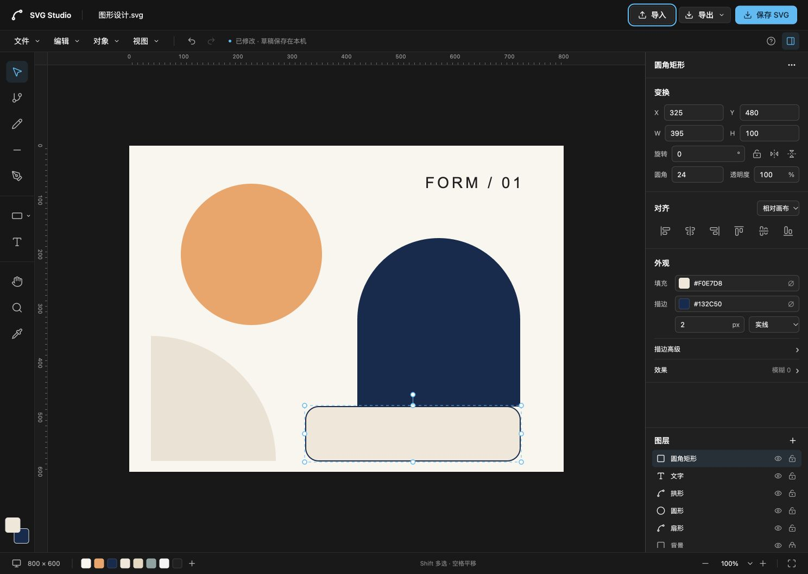

# SVG Studio

[English](README.en.md) · [示例 SVG](src/editor/sample.svg) · [已知问题](docs/known-issues.md) · [引擎接入](docs/engine.md)

[](https://github.com/Hello-job/svg-studio/actions/workflows/ci.yml)
[](LICENSE)

受 [GPT Image 2.6 的 SVG 输出能力](https://developers.openai.com/api/docs/guides/image-generation#generate-svg-output)启发，我们做了 SVG Studio：把 AI 生成的图标、插画导入浏览器，继续改色、调整形状、编辑路径，再导出用于项目。让生成后的局部修改也能更顺手。

独立的浏览器 SVG 编辑器，基于 **React + TypeScript + SVG-Edit + shadcn/ui**。默认黑白深色界面，文件在本地处理，无需登录或后端。



> **实验版 v0.1.0：** 部分属性修改未触发草稿保存，多选方向键移动可能覆盖原有变换。请保留原始文件并主动下载 SVG，详见[已知问题](docs/known-issues.md)。

## 功能

- **绘图与路径**：基础形状、铅笔、钢笔、文字、节点编辑。
- **属性与外观**：位置、尺寸、旋转、填充、描边、透明度、圆角与模糊。
- **对象与图层**：组合、排序、对齐、显隐、锁定、重命名、撤销/重做。
- **文件与视图**：SVG 导入/源码编辑、SVG/PNG 导出、缩放、平移、标尺。
- **主题**：默认黑白，可选预设色或自定义 HEX，偏好保存在当前浏览器。

## 本地运行

需要 Node.js 22.12+（推荐 24）和 pnpm 11。

```sh
git clone https://github.com/Hello-job/svg-studio.git
cd svg-studio
corepack enable
pnpm install --frozen-lockfile
pnpm dev
```

打开 [http://127.0.0.1:4317/](http://127.0.0.1:4317/)。左侧绘图、右侧改属性，Shift 多选，空格/H 平移；帮助按钮可查看快捷键。

## 安装 React 组件

在已配置 shadcn/ui 和 Tailwind CSS 的 React 项目中执行：

```sh
pnpm dlx shadcn@latest add https://raw.githubusercontent.com/Hello-job/svg-studio/main/public/r/svg-studio.json
```

```tsx
"use client";
import { SvgStudio } from "@/components/svg-studio";

<SvgStudio
  editorUrl="https://your-svg-studio.vercel.app/"
  filename="design.svg"
  onChange={(svg) => console.log(svg)}
  onSave={({ svg, filename }) => console.log(filename, svg)}
/>;
```

`editorUrl` 使用自己的部署地址。安装的是组件与通信协议源码；完整编辑器在 iframe 内运行，隔离样式和引擎生命周期，支持多实例和重复挂载。`defaultValue` 设置初始 SVG，`value / onChange` 支持受控编辑，`onReady / onError` 返回载入结果。传入 `onSave` 后由宿主处理保存，否则直接下载。输入上限 5 MB，组件不读写独立编辑器的本机草稿。详见[接入说明](docs/engine.md)。

## 部署

```sh
pnpm build
pnpm preview
```

Vercel 导入此仓库即可，已提供 `vercel.json`：Vite、`pnpm build`、输出 `dist/`，无需环境变量或后端。首页直接编辑，`/install.html` 提供安装命令和实时组件示例，`/r/svg-studio.json` 是公开 Registry。构建也会重新生成 Registry，源码与下载内容保持一致。

也可用静态服务器托管 `dist/`。子目录部署使用 `pnpm build --base=/svg-studio/`。

## 开发与贡献

```sh
pnpm typecheck && pnpm lint && pnpm format:check && pnpm test && pnpm build
```

界面与主题可从 `src/components/ui/`、`src/styles.css` 和 `src/lib/theme.ts` 修改。开发约定见 [AGENTS.md](AGENTS.md)，功能边界与验证范围见[已知问题](docs/known-issues.md)。

欢迎提交 [Issue](https://github.com/Hello-job/svg-studio/issues) 或 [PR](https://github.com/Hello-job/svg-studio/pulls)，请附浏览器、最小 SVG、复现步骤与验证结果，避免上传敏感作品或凭据。界面改动还需验证编辑、历史与导出流程。

## 许可证

原创代码使用 [MIT License](LICENSE)。SVG-Edit、shadcn/ui 等第三方代码保留原许可，见 [THIRD_PARTY_NOTICES.md](THIRD_PARTY_NOTICES.md)。
